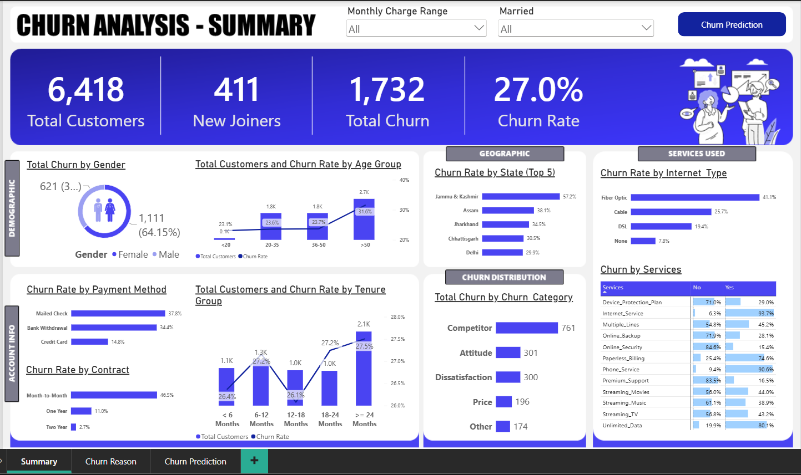
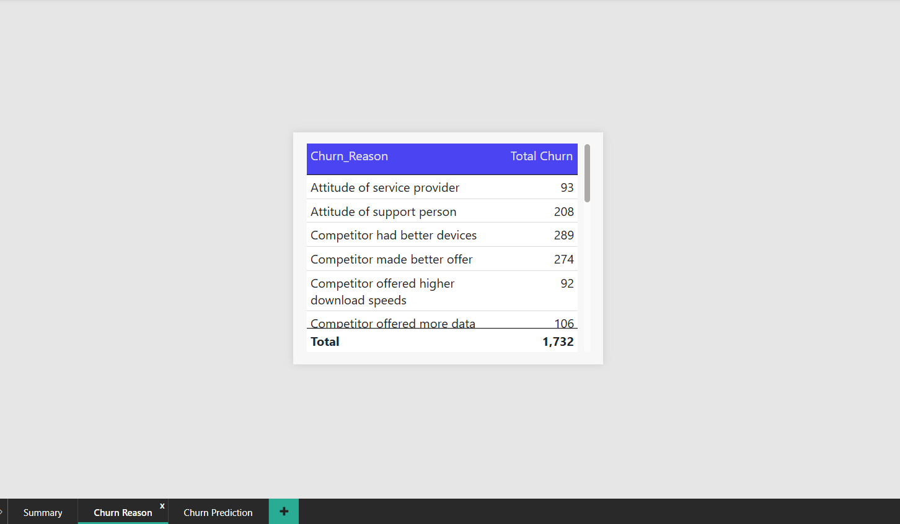
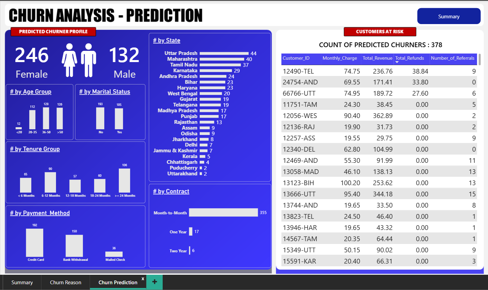

# 📊 Telecom Customer Churn Analysis & Prediction

An end-to-end Data Analytics and Machine Learning project focused on analyzing customer churn, identifying the key factors driving customer attrition, and predicting customers at risk of leaving a telecommunications company.

---

## 📌 Project Overview

Customer churn is one of the major challenges faced by telecommunications companies, as losing existing customers directly impacts revenue and long-term business growth.

This project analyzes **6,418 customer records** to understand customer churn patterns, identify the major reasons behind customer exits, and predict potential churners among newly joined customers.

The project combines **SQL Server, Python, Machine Learning, and Power BI** to transform customer data into meaningful business insights and actionable customer retention strategies.

## 🎯 Project Objectives

- Analyze overall customer churn and identify important churn patterns.
- Understand how churn varies across demographics, contracts, billing methods, and services.
- Identify the primary reasons customers leave the telecom company.
- Develop a Machine Learning model to predict customer churn.
- Identify newly joined customers who may be at risk of churning.
- Build an interactive Power BI dashboard to communicate findings and support business decisions.

## 🛠️ Technologies & Tools Used

| Technology | Purpose |
|---|---|
| SQL Server | Data querying and analysis |
| Python | Data analysis and model development |
| Pandas | Data manipulation and preparation |
| Scikit-learn | Machine Learning |
| Random Forest | Customer churn prediction |
| Matplotlib | Data visualization |
| Seaborn | Exploratory data visualization |
| Power BI | Interactive dashboard development |
| Excel | Supporting data analysis |

## 📂 Dataset Overview

The dataset contains **6,418 customer records** and 32 columns covering the following categories:

- **Demographics:** Gender, age, marital status, and state.
- **Account Information:** Tenure, contract type, value deal, payment method, and referrals.
- **Services:** Phone service, internet service, online security, device protection, premium support, and streaming services.
- **Financial Information:** Monthly charges, total charges, refunds, additional charges, and total revenue.
- **Customer Status:** Stayed, Churned, or Joined.
- **Churn Information:** Churn category and churn reason.

### Dataset Segmentation

| Customer Category | Records |
|---|---:|
| Stayed | 4,275 |
| Churned | 1,732 |
| New Joiners | 411 |
| **Total** | **6,418** |

Historical customers with known outcomes were used for analysis and model training, while newly joined customers were used for churn prediction.

## 🔄 Project Workflow

1. **Data Preparation:** Organized customer data and examined missing values, unusual values, and data quality.
2. **SQL Analysis:** Used SQL Server to query and analyze customer information.
3. **Exploratory Data Analysis:** Examined churn across demographics, contracts, payment methods, tenure, and services.
4. **Churn Reason Analysis:** Investigated customer exit reasons and identified major churn categories.
5. **Predictive Modeling:** Developed a Random Forest classification model using historical customer data.
6. **Customer Prediction:** Applied the trained model to 411 newly joined customers.
7. **Dashboard Development:** Created a three-page interactive Power BI dashboard to present the findings.

## 📈 Key Business Insights

### 1. Overall Customer Churn

- Overall churn rate: **27.0%** across all 6,418 records.
- Churn rate among customers with known outcomes: **28.8%**.
- Churned customers contributed approximately **17.5% of total revenue**.

### 2. Contract Type

Month-to-month customers showed significantly higher churn rates.

| Contract Type | Churn Rate |
|---|---:|
| Month-to-month | 46.5% |
| One-year | 11.0% |
| Two-year | 2.7% |

### 3. Reasons for Customer Churn

| Churn Category | Customers | Share |
|---|---:|---:|
| Competitor | 761 | 44% |
| Attitude | 301 | 17% |
| Dissatisfaction | 300 | 17% |
| Price | 196 | 11% |
| Other | 174 | 10% |

Competitor offers, better devices, and customer support experience emerged as important areas of concern.

### 4. Service-Related Insights

- Fiber optic customers had a churn rate of **41.1%**.
- Customers without premium support had a churn rate of **42.2%**.
- Customers without online security had a churn rate of **42.4%**.

These patterns highlight opportunities for further investigation into service quality, customer experience, and retention strategies.

## 🤖 Machine Learning Model

A **Random Forest Classifier** was developed to predict whether historical customers would stay or churn.

### Model Development

- Algorithm: Random Forest Classifier
- Number of estimators: 100
- Training and testing split: 80:20
- Evaluation dataset: 1,202 customers
- Target variable: Stayed or Churned

### Model Performance

| Evaluation Metric | Churned Class | Stayed Class |
|---|---:|---:|
| Precision | 0.78 | 0.86 |
| Recall | 0.65 | 0.92 |
| F1-Score | 0.71 | 0.89 |

**Overall Accuracy: 84%**

The model correctly identified 229 actual churners out of 355 customers who actually churned in the test dataset.

### Prediction on New Customers

The trained model was applied to **411 newly joined customers** and flagged **378 customers** as potential churn risks.

These predictions should be treated as a risk-ranking output rather than a confirmed forecast of future churn. Further validation and probability-based scoring are recommended before business deployment.

## 📊 Power BI Dashboard

An interactive Power BI dashboard was developed with three pages to present customer churn patterns, churn reasons, and predicted churn risks.

### 1. Summary Dashboard

Provides an overview of customer distribution, overall churn, revenue, and important churn patterns.



### 2. Churn Reason Dashboard

Highlights the major reasons behind customer exits, including competitor-related factors, dissatisfaction, and service experience.



### 3. Churn Prediction Dashboard

Presents the profile of customers identified as potential churn risks, helping prioritize customer retention efforts.



## 💡 Business Recommendations

Based on the analysis, the following strategies could help improve customer retention:

1. **Encourage Long-Term Contracts:** Offer incentives to month-to-month customers to move towards longer-term contracts.
2. **Address Competitor Threats:** Develop competitive device upgrade programs and attractive data bundles.
3. **Improve Customer Support:** Focus on support quality, employee training, and faster issue resolution.
4. **Investigate Fiber Optic Churn:** Review pricing, reliability, and installation experience.
5. **Promote Protective Services:** Evaluate bundled premium support and online security offerings.
6. **Review Payment Methods:** Test initiatives encouraging customers to adopt payment methods associated with lower observed churn.
7. **Proactive Retention Campaigns:** Prioritize outreach to customers identified as potential churn risks.
8. **Investigate High-Churn Regions:** Review network coverage and local competitor activity in regions with unusually high churn.

## ⚠️ Limitations & Future Improvements

- Improve churn recall through hyperparameter tuning, class weighting, and alternative modeling techniques.
- Compare Random Forest with Logistic Regression, XGBoost, and Gradient Boosting.
- Introduce churn probability scores and adjustable prediction thresholds.
- Investigate unusual negative monthly charges and inconsistencies in new customer billing data.
- Evaluate cumulative financial features that may introduce information leakage.
- Use cross-validation and time-based validation for more reliable model evaluation.
- Explore deploying the prediction model through an application for periodic customer risk scoring.

## 📁 Repository Structure

```text
├── dataset/
│   ├── Customer_Data.csv
│   ├── Predictions.csv
│   └── Prediction_Data.xlsx
│
├── notebook/
│   └── Churn_Prediction.ipynb
│
├── powerbi/
│   └── Churn_Analysis.pbix
│
├── report/
│   └── Telecom_Churn_Analysis_Report.docx
│
├── screenshots/
│   ├── summary.png
│   ├── churn_reason.png
│   └── churn_prediction.png
│
└── README.md
```

## 👨‍💻 Author

**Ramkumar Sharma**

B.Tech Information Technology | Aspiring Data Analyst

Interested in Data Analytics, Business Intelligence, SQL, Python, and Machine Learning.

---

